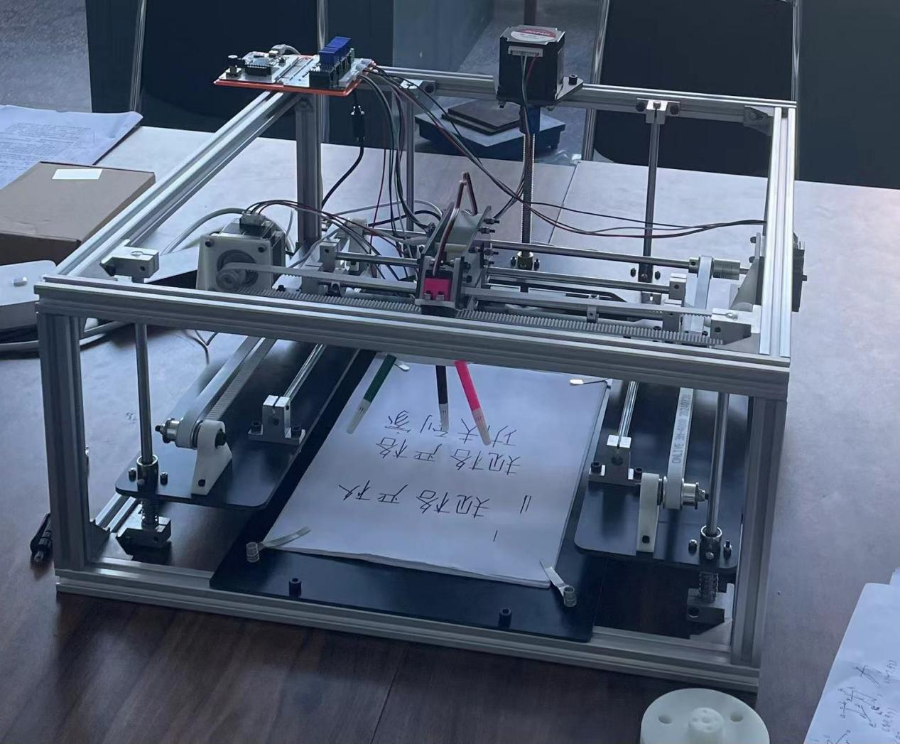
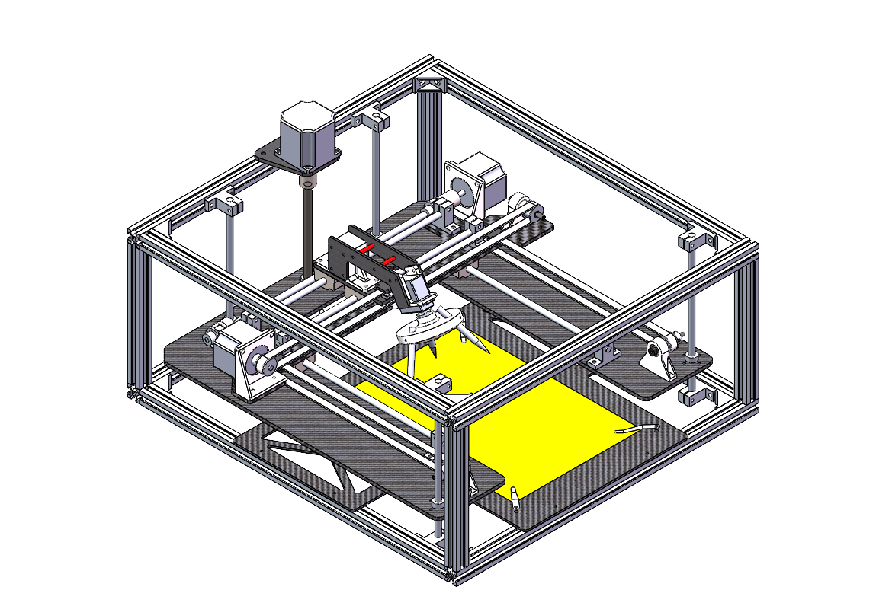

# Four Axis Gantry Robot

This industrial internship project brings together mechanical design, manufacturing files, a Python host application, calculation documents and a demonstration video.

## Prototype and mechanical layout

| Physical prototype | CAD assembly |
| --- | --- |
|  |  |

Images are extracted from the archived project report. [Watch/download the demonstration](media/完整视频.mp4) · [Read the report](docs/report.docx) · [Explore the host software](software/README.md).

The project connects mechanical layout, part manufacturing, assembly and a serial host application. The photograph and video document a historical prototype; no positioning-accuracy or repeatability benchmark is claimed here.

## Start here

- **Design and development:** open the [project documents](docs/), then read the group presentation or individual internship report.
- **Mechanical structure:** open `cad/模型final/总装.SLDASM` in SolidWorks. Parts and subassemblies are in the same directory.
- **Physical demonstration:** download and play the [complete video](media/完整视频.mp4).
- **Control software:** use the [software guide](software/README.md) to find the GUI and serial-control sources.
- **Manufacturing:** `manufacturing/板材/` contains DXF files and `manufacturing/打印件/` contains STL files. Original thickness and quantity information remains in the filenames.

This repository organizes a historical project. Software and hardware have not been retested together, and SolidWorks assembly references have not been verified. It includes group work and host-application code whose sources still need confirmation. Third-party code provenance and reuse terms have not been fully documented; publication of this archive does not assign blanket authorship or licensing rights.

## Contents

| Directory | Contents |
| --- | --- |
| `cad/模型final/` | Original assemblies and parts. Start with `总装.SLDASM`. |
| `manufacturing/板材/` | DXF files for 3 mm and 5 mm sheet parts |
| `manufacturing/打印件/` | STL printing files |
| `software/host-app/` | Python serial host application, Qt UI and historical debugging scripts |
| `software/experiments/` | Original `wlfcode1.py` experiment |
| `docs/` | Group presentation, individual report, motor calculations and debugging notes |
| `media/完整视频.mp4` | Complete project demonstration |

## Download models and video

Git LFS manages CAD, Office documents and video. After cloning, run:

```sh
git lfs install
git lfs pull
```

Open `cad/模型final/总装.SLDASM` in SolidWorks. All files and names from the original model directory have been retained. If references are missing, locate the files in that directory through SolidWorks and check the assembly.

## Host application environment

The dependency list was inferred from source imports. Versions have not been pinned or validated. Install Python 3 and run these PowerShell commands from `software/host-app/`. They use the virtual environment interpreter directly without activating a script.

```powershell
python -m venv .venv
.\.venv\Scripts\python.exe -m pip install -r requirements.txt
.\.venv\Scripts\python.exe scara_host_app.py
```

`scara_host_app.py` contains the GUI entry point. `main.py` is a historical debugging script, not the application entry point. Confirm the controller model, serial settings, wiring, limits and homing procedure against the original notes and actual hardware. The repository is not guaranteed to operate immediately when connected to a device.


---

# 中文

# 龙门架四轴机械臂

生产实习中的四轴机械臂项目，集中保存机械设计、制造文件、Python 上位机、计算资料和演示视频。

实物照片与 CAD 总装预览见上方，均提取自归档报告；演示视频入口已置于首页。它们记录历史样机，不代表已验证定位精度或重复精度。

## 从这里开始

- **了解设计与过程**：查看 [项目文档](docs/)，选择小组汇报或个人实习报告。
- **查看机械结构**：使用 SolidWorks 打开 `cad/模型final/总装.SLDASM`，零件与子装配位于同一目录。
- **查看实物演示**：下载 [完整视频](media/完整视频.mp4) 后播放。
- **查看控制程序**：从 [软件说明](software/README.md) 进入 GUI 与串口控制源码。
- **制作零件**：`manufacturing/板材/` 提供 DXF，`manufacturing/打印件/` 提供 STL；文件名中保留原有厚度与数量信息。

这是历史项目的整理版本。软件和硬件尚未重新联调，SolidWorks 装配引用尚未验证。项目包含小组成果及来源待确认的上位机代码，第三方代码来源及复用条款尚未完整核实，公开归档不代表对全部材料统一主张作者身份或授予许可证。

## 内容

| 目录 | 内容 |
| --- | --- |
| `cad/模型final/` | 原始装配及零件，入口为 `总装.SLDASM` |
| `manufacturing/板材/` | 3 mm、5 mm 板材 DXF 加工文件 |
| `manufacturing/打印件/` | STL 打印文件 |
| `software/host-app/` | Python 串口上位机、Qt UI 和历史调试脚本 |
| `software/experiments/` | 原始 `wlfcode1.py` 实验脚本 |
| `docs/` | 小组汇报、个人实习报告、电机计算及调试说明 |
| `media/完整视频.mp4` | 项目演示视频 |

## 获取模型和视频

本仓库使用 Git LFS 管理 CAD、Office 文档及视频。克隆后运行：

```sh
git lfs install
git lfs pull
```

使用 SolidWorks 打开 `cad/模型final/总装.SLDASM`。整理时保留了模型目录中的全部文件和原文件名；若出现丢失引用，应在 SolidWorks 中重新定位到该目录并检查装配。

## 上位机环境

根据源码导入整理了依赖清单，尚未锁定或验证版本。安装 Python 3，在 `software/host-app/` 目录创建虚拟环境并运行以下 PowerShell 命令（直接使用虚拟环境解释器，无需激活脚本）：

```sh
python -m venv .venv
.\.venv\Scripts\python.exe -m pip install -r requirements.txt
.\.venv\Scripts\python.exe scara_host_app.py
```

`scara_host_app.py` 是含 GUI 启动代码的入口；`main.py` 是历史调试脚本，不作为启动入口。控制器型号、串口参数、接线、限位和回零步骤需依据原始调试说明及实物补充确认，当前仓库不保证直接连接设备即可使用。

